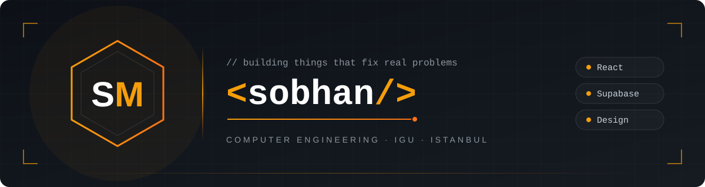

<div align="center">

# 📜 License · Golfroshi Flower Atelier

### You can use my work. You just can't pretend it's yours.


**Copyright (c) 2026 Sobhan Mirgholami (Co$mo)**

🔗 [Source](https://github.com/SobhanMirgholami/golfroshi) · 👨‍💻 [Author](https://sobhan-cosmo.vercel.app) · ✉️ sobhan.mirgholami.dev@gmail.com

</div>

---

## 💡 In one sentence

You're free to copy, change and use this project, as long as you **credit me** or **get my permission**, and you **never claim it as your own**.

---

## ✅ What you can do

You may **copy, modify, merge, use, publish, deploy and share** this project or any part of it, as long as you do **at least one** of these:

- 🏷️ **Give me credit:** keep this license file in your copy, and show a visible credit (see below) in your README, your app's about or credits page, or wherever you describe the project.
- ✉️ **Get my permission in writing:** an email is enough. Tell me what you want to use and how.

---

## 🏷️ How to credit me

Add this line where people will see it:

```
Based on work by Sobhan Mirgholami (Co$mo) - https://sobhan-cosmo.vercel.app
```

In a README, you can use:

```markdown
Based on [Golfroshi Flower Atelier](https://github.com/SobhanMirgholami/golfroshi) by [Sobhan Mirgholami (Co$mo)](https://sobhan-cosmo.vercel.app)
```

---

## 🚫 What you can never do

- 🙅 Claim this project, or any part of it, as **your own original work**
- ✂️ Remove or change this license, the copyright line, or any **author identifiers inside the code**
- 🤝 Suggest that I **made, support or approve** your version unless I said so

---

## 📦 Third-party stuff

Libraries, fonts, icons, logos and other third-party assets used in this project stay under **their own licenses**. Trademarks belong to their owners. This license only covers **my own work**.

---

## 💐 Sample bouquets

The sample bouquet illustrations in `public/bouquets/` and the sample names and descriptions were made for this project and are covered by this license like the rest of my work. **Golfroshi** is a demo shop name; if you use this for a real shop, replace the name, texts and photos with your own.

---

## ✉️ Asking for permission

- 📧 Email: **sobhan.mirgholami.dev@gmail.com**
- 💬 Telegram: **[@Cosmodev2099](https://t.me/Cosmodev2099)**

> 💡 Permission only counts when it's written (email or message), and only for the use we agreed on.

---

## ⚖️ No warranty

> This software is provided **"as is"**, without warranty of any kind. In no event shall the author be liable for any claim, damages or other liability arising from the use of this software.

---

<div align="center">

Made with 💐 and late nights in Istanbul

⭐ Using my work? A star and a credit go a long way!

</div>