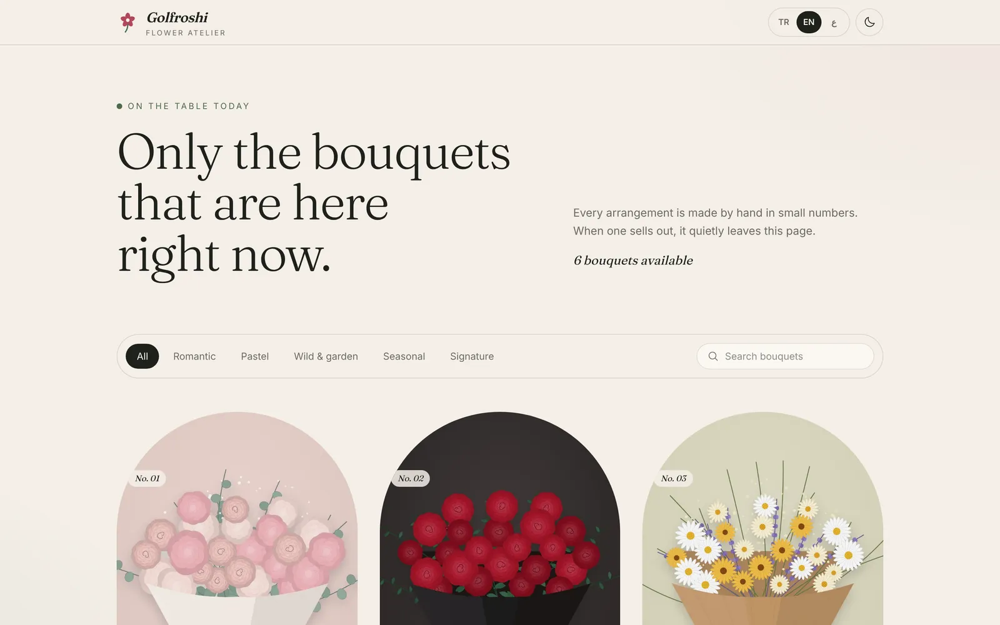
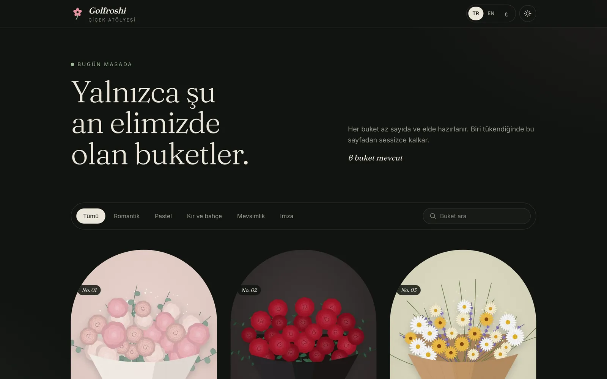
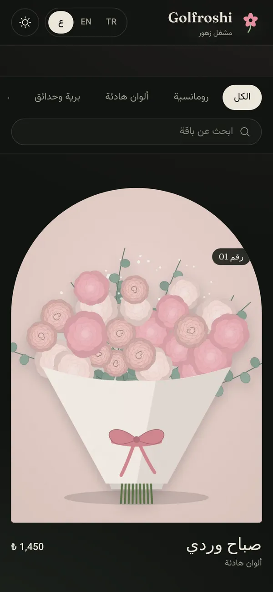
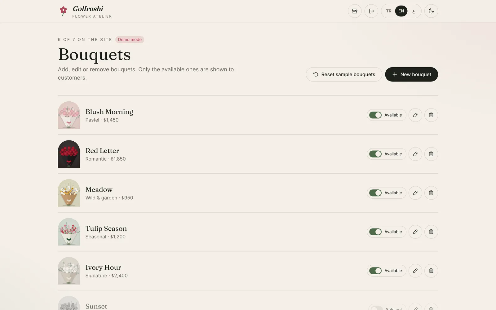
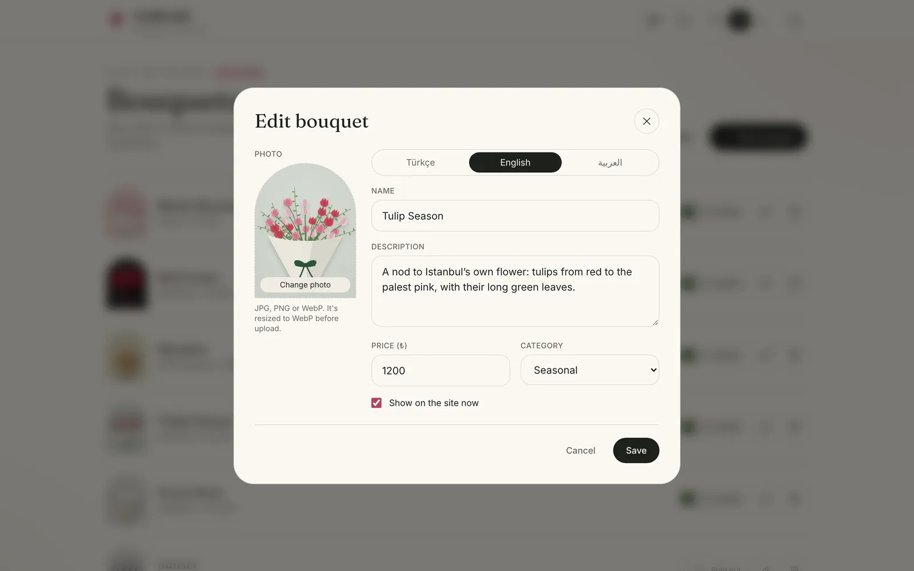

<div align="center">

# 💐 Golfroshi Flower Atelier

### Only the bouquets that are in the shop right now. The florist updates it themselves.


**🇹🇷 Türkçe · 🇬🇧 English · 🇸🇦 العربية (right-to-left) · 🌗 Light & dark · 📱 Mobile first**

</div>



---

## 💡 Why I built this

A small flower shop doesn't need a full online store. It needs one page that says **what's on the table today**, with a photo and a price, and a way for the florist to change that from their phone in a few seconds.

So the public site shows **only the available bouquets**. When a bouquet sells out, the florist flips a switch and it quietly disappears. Same idea as my [Cafe Roll menu](https://github.com/SobhanMirgholami/roll-menu), rebuilt for flowers, three languages and two themes. 🌷

---

## 🎨 Design

**Minimal, editorial and a little bit botanical.**

- 🏛️ Every bouquet sits in an **arch**, like a greenhouse window
- 📰 Big **Fraunces** serif headlines, **Inter** for text, **Vazirmatn** for Arabic
- 🌗 **Paper & ink** light theme, **dark greenhouse** night theme; the switch grows out of the button as a circle
- 🔢 Bouquets are numbered *No. 01, No. 02…* like a catalogue
- 🌀 Cards animate in and out when you filter, and respect "reduce motion"
- ↔️ Arabic flips the whole layout right-to-left, with no letter spacing or fake italics on Arabic text

<table>
<tr>
<td width="62%"></td>
<td width="38%"></td>
</tr>
</table>

---

## ✨ Features

### 💐 For customers
- 👀 Only bouquets that are available right now
- 🗂️ Filter by category: romantic, pastel, wild & garden, seasonal, signature
- 🔎 Search by name in any language
- 🖼️ Tap a bouquet for a big photo, description and price in lira
- 🌍 Turkish, English and Arabic, remembered for next time
- 🌗 Light and dark themes that follow the phone, or your choice

### 🧑‍🌾 For the florist
- 🔐 Sign-in, protected admin page, sign-out
- ➕ Add, ✏️ edit and 🗑️ delete bouquets
- 🔁 One switch for **available / sold out**
- 🌍 Name and description written in all three languages, each field typed in its own direction
- 🖼️ Photos are resized to 960px WebP **in the browser** before upload
- 🧪 **Demo mode** with 7 sample bouquets, so the whole thing works without any backend

<table>
<tr>
<td></td>
<td></td>
</tr>
</table>

---

## 🧪 Demo mode vs. Supabase

| | Demo mode | Supabase |
|---|---|---|
| When | No Supabase values in `.env.local` | Both Supabase values set |
| Bouquets live in | This browser (localStorage) | PostgreSQL |
| Photos live in | This browser | Supabase Storage |
| Admin sign-in | Password only (`golfroshi`, or `VITE_DEMO_PASSWORD`) | Email + password, account must be in `admin_users` |
| Good for | Trying it, showing it, a portfolio | A real shop |

> ⚠️ The demo password only protects the demo screens in your own browser. For a real shop, use Supabase.

---

## 🔒 Security (Supabase mode)

- 🛡️ **Row Level Security** on every table
- 👀 Visitors can only read bouquets where `is_available` is true, so sold-out ones never leave the database
- 👥 **Admin list in the database:** being signed in isn't enough, the account must be in `admin_users`
- 🚪 No admin sign-up in the app; admins are added from the Supabase dashboard
- 🖼️ Only admins can upload or delete photos; JPG, PNG or WebP up to 2 MB
- 🔑 Only the **publishable** key in the frontend
- 🧹 A photo is deleted when its bouquet is deleted or gets a new photo, if nothing else uses it

---

## 🛠️ Tech stack

| | Technology |
|---|---|
| ⚛️ Frontend | React 19 + Vite 8 |
| 🧭 Routing | React Router 7 (shop, login, protected admin) |
| 🎨 Styling | Tailwind CSS 4 with CSS variable themes |
| 🌍 Languages | i18next + react-i18next |
| 🌀 Animation | Motion |
| 🗄️ Database | PostgreSQL (Supabase), optional |
| 🔑 Auth | Supabase Auth (email + password) |
| 🖼️ Images | Supabase Storage |
| 🔔 UI | react-hot-toast, Phosphor Icons |

---

## 📁 Project structure

<details>
<summary>Click to expand</summary>

```
src/
├── main.jsx                  🚪 Entry point
├── i18n.js                   🌍 Languages, right-to-left switch, pick()
├── index.css                 🎨 Theme tokens, fonts, buttons, the arch
├── locales/                  🗣️ tr.json · en.json · ar.json
├── components/
│   ├── App.jsx               🧭 Routes, bouquet state and actions
│   ├── Header.jsx            🔝 Logo, language and theme
│   ├── Logo.jsx              💐 Wordmark and flower mark
│   ├── LanguageSwitcher.jsx  🌍 TR · EN · ع
│   ├── ThemeToggle.jsx       🌗 Light / dark with a circle reveal
│   ├── BouquetCard.jsx       🃏 Arch card on the shop page
│   ├── BouquetDialog.jsx     🔍 Big photo and description
│   ├── BouquetForm.jsx       ✏️ Add / edit in three languages
│   ├── ProtectedRoute.jsx    🔐 Admin access check
│   └── Loading.jsx           ⏳ Spinning flower
├── pages/
│   ├── ShopPage.jsx          💐 The public shop
│   ├── LoginPage.jsx         🔐 Sign-in
│   └── AdminPage.jsx         🧑‍🌾 Admin dashboard
└── lib/
    ├── productService.js     🔌 Demo storage or Supabase
    ├── adminAccess.js        👥 Sign-in and admin check
    ├── sampleBouquets.js     🌷 The 7 sample bouquets and categories
    ├── optimizeImage.js      🖼️ Resize to WebP before upload
    ├── supabaseClient.js     🔌 Supabase client (or demo mode)
    ├── theme.js              🌗 Theme storage
    ├── format.js             💰 Lira formatting per language
    └── buildInfo.js          🏷️ Build info

public/bouquets/              🌷 Sample bouquet illustrations
supabase/schema.sql           🗄️ Tables, security rules, bucket, sample data
preview/                      📸 Screenshots for this README
```

</details>

---

## 🚀 Getting started

**1. Install**
```bash
npm ci
```

**2. Run it (demo mode)**
```bash
npm run dev
```

Open `http://localhost:5173`. The admin panel is at `/login` → `/admin`, password **`golfroshi`**.

**3. Connect Supabase (optional)**

<details>
<summary>🗄️ Database, security rules, photo bucket and admin account</summary>

1. Create a Supabase project and open the **SQL Editor**.
2. Run [`supabase/schema.sql`](supabase/schema.sql). It creates the `bouquets` and `admin_users` tables, the security rules, the `bouquet-images` bucket and the 7 sample bouquets.
3. Turn on email/password sign-in in **Authentication**, create the florist's account, and add its UUID:
   ```sql
   insert into public.admin_users (user_id) values ('REPLACE_WITH_AUTH_USER_UUID') on conflict do nothing;
   ```
4. Create `.env.local` next to `package.json`:
   ```dotenv
   VITE_SUPABASE_URL=https://YOUR_PROJECT_REF.supabase.co
   VITE_SUPABASE_PUBLISHABLE_KEY=YOUR_SUPABASE_PUBLISHABLE_KEY
   ```
5. Restart `npm run dev`.

> ⚠️ Use the **publishable** key only. Secret / service-role keys never go in the frontend, and `.env.local` never goes on GitHub.

</details>

<details>
<summary>🚀 Deploy</summary>

| Setting | Value |
| --- | --- |
| Build command | `npm run build` |
| Publish directory | `dist` |
| Environment variables | `VITE_SUPABASE_URL`, `VITE_SUPABASE_PUBLISHABLE_KEY` (leave out for demo mode) |

`public/_redirects` (Netlify) and `vercel.json` (Vercel) make refreshing `/login` and `/admin` work.

</details>

---

## 🗺️ Roadmap

### ✅ Done
- [x] 💐 Shop page with only available bouquets
- [x] 🌍 Turkish, English and Arabic (right-to-left)
- [x] 🌗 Light and dark themes
- [x] 🧑‍🌾 Admin: add, edit, delete, sold-out switch
- [x] 🖼️ Photo upload with in-browser WebP resize
- [x] 🛡️ Supabase schema with Row Level Security
- [x] 🧪 Demo mode with 7 sample bouquets

### 📌 Planned
- [ ] 🚀 Live demo
- [ ] 📲 "Order on WhatsApp" button on each bouquet
- [ ] 📡 Live updates with Supabase Realtime
- [ ] ↕️ Drag to reorder bouquets

---

## 📜 License

This project has its own license. **Please read [LICENSE.md](LICENSE.md) before using the code.**

- ✅ You can copy, change and use the code **if you credit me** or **get my permission**
- 🚫 You can't claim it as your own work
- 📦 Fonts and libraries keep their own licenses

---

## 👨‍💻 About me

Hi, I'm **Sobhan Mirgholami**, a Computer Engineering student at **Istanbul Gelişim University**. I love programming, design, and solving real problems I see around me. 💐

[Portfolio](https://sobhan-cosmo.vercel.app) · [LinkedIn](https://www.linkedin.com/in/sobhan-mirgholami-a2093b417/) · [GitHub](https://github.com/SobhanMirgholami)

---

<div align="center">

Made with 💐 and late nights in Istanbul

⭐ If you like this project, give it a star!

</div>
